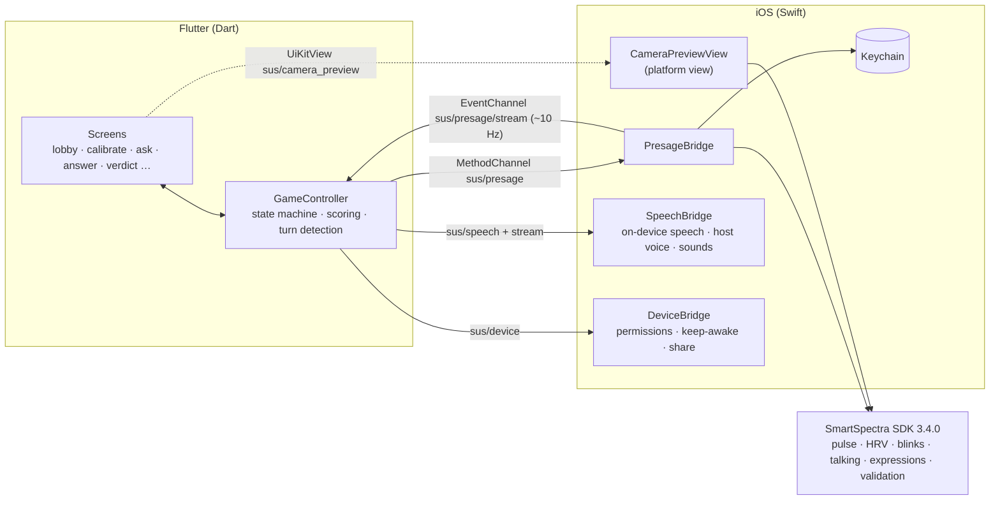

# Sus-o-meter

**A camera-and-voice party game for iPhone.** One player sits in the hot seat, friends ask
questions out loud, and the app reads the player's live pulse, blinks, expressions and hesitation
with the [Presage SmartSpectra SDK](https://smartspectra.presagetech.com/docs/swift/), then
delivers a 70s game-show verdict: **Legit / Hmm… / Sus!**

> **It reads stress, not truth.** Sus-o-meter is an entertainment game. It is not a lie
> detector and not a medical device. A racing pulse means "nervous", never "guilty".

Built for the DEV [Presage SmartSpectra SDK Challenge](https://dev.to/challenges/presage-2026-11-04)
(`#presagechallenge`). Design and build spec: [`docs/SPEC.md`](docs/SPEC.md). Mockups:
[`docs/design/`](docs/design/).

## Contents

- [How a game goes](#how-a-game-goes)
- [Requirements](#requirements)
- [Setup](#setup)
- [Your Presage API key](#your-presage-api-key)
- [Permissions](#permissions)
- [Privacy and data handling](#privacy-and-data-handling)
- [How the score works](#how-the-score-works)
- [How turn-taking works](#how-turn-taking-works)
- [Architecture](#architecture)
- [Proof Panel](#proof-panel)
- [Development](#development)
- [Known limitations](#known-limitations)
- [Credits](#credits)

## How a game goes

1. **Lobby:** add 2–8 contestants (or 1+ in *Solo · host asks*), pick 3/5/7 questions per turn
   and a Mild or Spicy deck.
2. **Consent:** the phone goes to the hot-seat player, who reads what the camera measures and
   what happens to the data, then taps *I agree, measure me* or *Skip my turn*.
3. **Calibrate:** about 20 s of sitting still, then 2–3 easy warm-up questions read by the host.
   This learns *your* normal pulse, blink rate, expressions and how fast you usually answer.
4. **Ask:** a friend asks a question out loud; it appears on screen as they speak. In solo mode
   the host reads one from the deck, and it stays on screen until you start answering or tap
   *Ready to answer*.
5. **Answer:** the player answers out loud and smashes *Final answer* (or just stops talking).
6. **Call it!:** everyone else votes Legit or Sus *before* the reveal.
7. **Countdown → Verdict:** drumroll, 3-2-1, then the scoreboard, applause meter and what moved.
8. **Leaderboard:** Best poker face, Most sus, Best lie detector, Biggest spike, and a Replay of
   every question. *Wipe everything* clears it all.

## Requirements

- A Mac with **Xcode 26 or later** (the SmartSpectra binary is built with Swift 6.2)
- An **iPhone on iOS 17+** (the simulator has no camera)
- **Flutter 3.38+** (tested with 3.47.9, which uses Swift Package Manager; no CocoaPods)
- A **Presage API key** (free) from [physiology.presagetech.com](https://physiology.presagetech.com)
- An internet connection when a game starts (the SDK signs in; readings stay on the phone)

## Setup

```bash
git clone https://github.com/littlepaprikalab/susometer.git
```
```bash
cd susometer && flutter pub get
```
```bash
open ios/Runner.xcworkspace
```

In Xcode, select the **Runner** target → **Signing & Capabilities** and choose your team (change
the bundle identifier if `com.littlepaprikalab.susometer` is taken). Xcode downloads the
SmartSpectra Swift package (~60 MB) the first time. Then connect your iPhone and run:

```bash
flutter run
```

On first launch, open **Settings** (gear icon), paste your Presage key and tap **Save & test**.
Tapping *Start the show* without a key opens Settings for you.

**Optional, debug builds only:** to skip pasting the key during development, copy
`ios/Flutter/Secrets.example.xcconfig` to `ios/Flutter/Secrets.xcconfig` (gitignored) and set
`PRESAGE_API_KEY`. On the first debug launch with an empty Keychain it's copied into the
Keychain once. Release builds never read it.

## Your Presage API key

1. Register at [physiology.presagetech.com](https://physiology.presagetech.com/auth/register)
   and confirm your email.
2. Log in and copy your API key from the portal.
3. In the app: **Settings → Presage API key → Paste → Save & test**. The chip turns
   **Connected** when Presage accepts it, or **Key rejected** with the SDK error code.

The key is stored in the iPhone's **Keychain** (this device only, after first unlock). Dart sends
it to Swift once, on save; it never comes back (Settings only shows `••••1a2b`). It's used only to
sign in to Presage. **Remove** deletes it; deleting the app does too (iOS keeps Keychain items
after an uninstall, so the app wipes any leftover key on its first launch after a fresh install).

For production, Presage's OAuth (App Attest) option would remove the key entirely; only
`configure()` in `PresageBridge.swift` and `Info.plist` would change.

## Permissions

| Permission | Needed? | Used for |
|---|---|---|
| Camera | **Required** | SmartSpectra reads pulse, blinks, expressions and talking from the front camera |
| Microphone | Optional | Hears the question and the answer |
| Speech recognition | Optional | Turns speech into on-screen text, **on this phone only** |

Without the mic you can still play: tap *Done asking*, then *Final answer*, with no transcripts.
If on-device recognition isn't available for your language, the app never falls back to Apple's
servers; it switches to tap-to-advance instead.

## Privacy and data handling

| Data | Where | Retention | Shared? |
|---|---|---|---|
| Camera video | Processed on-device by SmartSpectra | Never stored | Never |
| Vitals and face signals | In-memory game state | Until the game ends or *Wipe everything* | Never |
| Audio | On-device Apple speech recognition (`requiresOnDeviceRecognition = true`) | Never stored | Never |
| Transcripts (questions and answers) | In memory | Until *Wipe* or the app closes | Never. Not on the share card |
| Names and scores | In memory | Until *Wipe* or the app closes | Only if you tap *Share results* (an image with names, scores and awards) |
| SmartSpectra telemetry | SDK | n/a | **Off by default.** Opt in under Settings → SDK telemetry: an anonymous per-session diagnostic summary (no video, no vitals values, no identifiers) |
| Presage API key | iOS Keychain, this device only | Until *Remove* or the app is deleted | Sent only to Presage to start a session |
| SmartSpectra sign-in | The SDK contacts Presage with the key to start a session | n/a | Required by the SDK |
| AI / LLM services | **None used.** SmartSpectra LLM Insights is never requested | n/a | n/a |

- **No accounts, no analytics, no backend, no disk persistence.** Game data never touches
  `UserDefaults` or files. The only thing written outside the Keychain is one boolean used to
  detect a fresh install. Settings toggles reset every launch.
- **Consent** is collected per player, per game, from the person being measured (screen 2).
  *Skip my turn* is always available.
- **LLM Insights:** Presage documents auto-fired "vitals check-ins" that send pulse/HRV/breathing
  values to an LLM gateway when breathing and cardio metrics are both active. Sus-o-meter never
  requests breathing metrics, so that precondition is never met, and the app watches the SDK's
  `insight` property and shows **LLM insight seen** in the Proof Panel if one ever appears.
- See Presage's [telemetry and privacy page](https://smartspectra.presagetech.com/docs/telemetry-and-privacy).

## How the score works

Everything is relative to **your own baseline** from calibration (median pulse, blink rate,
expression means, warm-up answer speed). For each question the app measures the window from
when the question starts until the answer ends (at least 12 s after the question ends) and
normalizes four signals to 0–1:

| Signal | Formula | Weight |
|---|---|---|
| Pulse | (mean confident pulse − your baseline) ÷ 15 BPM | 0.45 |
| Blinks | ((rate − baseline) ÷ max(baseline, 6/min)) ÷ 0.6, or 0.6 for a 6 s "blink freeze" | 0.25 |
| Expressions | peak rise in surprise / fear / contempt / disgust above your normal ÷ 0.4 | 0.15 |
| Hesitation | (time to start answering − your usual) ÷ 3 s | 0.15 |

`score = round(100 × (weighted sum)^0.8)`. **Legit** under 35, **Hmm…** 35–59, **Sus!** 60+.

**No fake verdicts:** pulse samples below 40% confidence, or that arrive while SmartSpectra's
validation isn't OK, are ignored. If less than 60% of the window has a present face and a fresh
confident pulse, the result is **No clean read** with the real reasons (e.g. "The camera lost
Sam's face for about 5 seconds") and an *Ask it again* button. Every constant lives in
[`ScoringConfig`](lib/game/scoring_config.dart) for tuning.

**Expression #tag.** While the camera measures, the player's strongest expression is stamped in
its top-right corner as a #tag, in the SDK's own words (#surprise, #happy, #neutral…). SmartSpectra
gives a score per expression rather than one label, so the tag is the top score, smoothed over
about 0.6 s and changed only once a new one has clearly led for 0.7 s, so it doesn't flicker
and a tie never shows an arbitrary expression. Red ink
marks the four that move the score, teal the rest. It's hidden when no expression scores clearly,
there's no usable face, or the SDK stops sending new expression readings. It's the raw reading, not compared to the player's normal, so it's for
show; the score uses the comparison. Logic: [`lib/game/expression_tag.dart`](lib/game/expression_tag.dart).

## How turn-taking works

The host is the phone's voice. Speaker separation uses SmartSpectra's **talking** detection
instead of diarization: speech while the hot-seat player isn't talking is the question; speech
while they are is the answer.

- **Question ends** when the player starts talking, or after 1.5 s of silence following the
  asker (the host then asks "{name}, your answer?"), or with *Too loud? Tap when done asking*.
- **Answer ends** with *Final answer*, or 4 s after the player stops talking.
- **Half-duplex:** recognition is muted while the host speaks or a sound plays, and for 150 ms
  after, so the transcript never contains the host.

Details: [`lib/voice/turn_detector.dart`](lib/voice/turn_detector.dart) and SPEC §7.

## Architecture



- [`ios/Runner/Presage/PresageBridge.swift`](ios/Runner/Presage/PresageBridge.swift) configures
  the SDK, observes it with `withObservationTracking`, and streams snapshots (pulse + confidence,
  HRV, blink/talk edges, expressions, validation, status, errors).
- [`ios/Runner/Voice/SpeechBridge.swift`](ios/Runner/Voice/SpeechBridge.swift) runs
  `SFSpeechRecognizer` on-device only, plus the host's `AVSpeechSynthesizer` voice and sounds.
- [`lib/game/`](lib/game/) holds the game logic, which is pure Dart and unit-tested.

## Proof Panel

For judges and the demo video: turn on **Settings → Proof panel**, or long-press the lobby logo
(or tap it 5 times). On every measuring screen it overlays the raw SmartSpectra stream (pulse and
confidence, RMSSD and confidence, blink and talking flags, top expression, validation code and
hint, SDK status, telemetry state), the baseline, and the timing markers `tQ0 tQ1 tA0 tA1`.
**Settings → Signal check** opens a bare screen with the camera, live signals and the transcript
side by side.

## Development

```bash
flutter analyze
```
```bash
flutter test
```

Tests run without a device. They cover scoring and turn detection with synthetic SmartSpectra
streams, full games on fake time (controller and through the real screens at 390×844 with the
real fonts), accessibility actions and color contrast.

- **Swift type check on Linux/macOS without Xcode:** `tool/swift_typecheck/run.sh` checks the
  native bridge against stand-in modules (the SmartSpectra one mirrors the 3.4.0 interface).
  Needs a Swift 6.2 toolchain. It's a quick sanity check, not a substitute for an Xcode build.
- **Sounds and icon** are generated: `python3 tool/gen_sfx.py`, `python3 tool/gen_icon.py`
  (needs Pillow).
- **Claude Code cloud sessions** install Flutter through `.claude/hooks/session-start.sh`.
- Build decisions are logged at the end of [`docs/SPEC.md`](docs/SPEC.md).
- On-device test script: [`docs/DEVICE_CHECKLIST.md`](docs/DEVICE_CHECKLIST.md).

## Known limitations

- **It measures stress reactions, not honesty**, and only roughly: a webcam-grade, entertainment
  estimate. Not medical, not diagnostic, not a lie detector.
- **Light and position matter:** dim rooms, a bright window behind you, moving the phone, or a
  second face in frame all reduce signal quality. The app pauses and says why rather than guess.
- **Noise:** loud rooms make transcripts unreliable; use *Too loud? Tap when done asking*.
- **Talking detection** comes from the camera, so a mumbled answer may need the *Final answer* tap.
- **HRV** needs about 60 s of measurement; it's shown, not scored.
- **Network:** the SDK must sign in to start a session (E5 explains if it can't).
- **Languages:** transcripts need on-device recognition for the iPhone's language; otherwise the
  game is tap-to-advance.
- Heavy use warms the phone; between turns the app suggests a breather if iOS reports it's hot.

## Credits

- **Presage SmartSpectra SDK** for all vitals and face signals.
- **Fonts:** [Bowlby One SC](https://fonts.google.com/specimen/Bowlby+One+SC) by Vernon Adams and
  [Work Sans](https://fonts.google.com/specimen/Work+Sans) by Wei Huang, both under the SIL Open
  Font License ([`assets/fonts/`](assets/fonts/)).
- **Sound effects:** synthesized for this project by [`tool/gen_sfx.py`](tool/gen_sfx.py) and
  released under CC0. No third-party samples.
- Built with Flutter and Swift. Design and code written with Claude Code.
